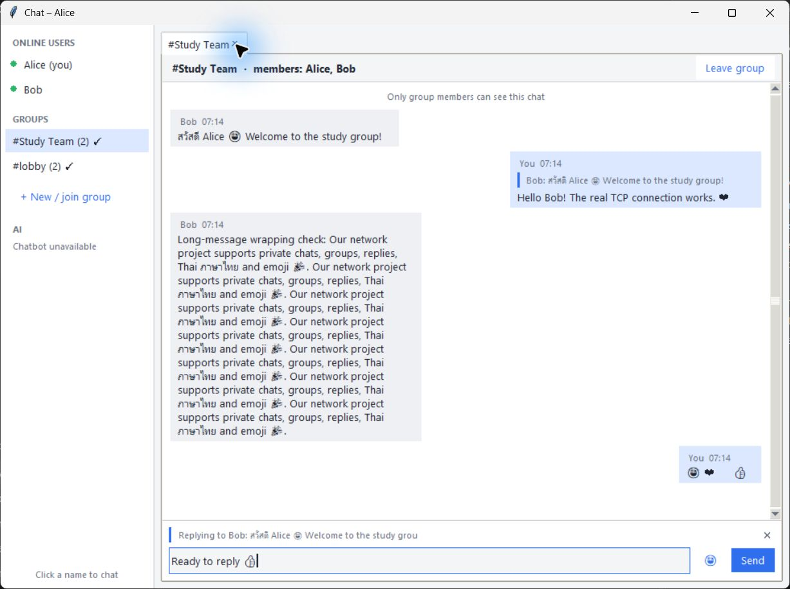
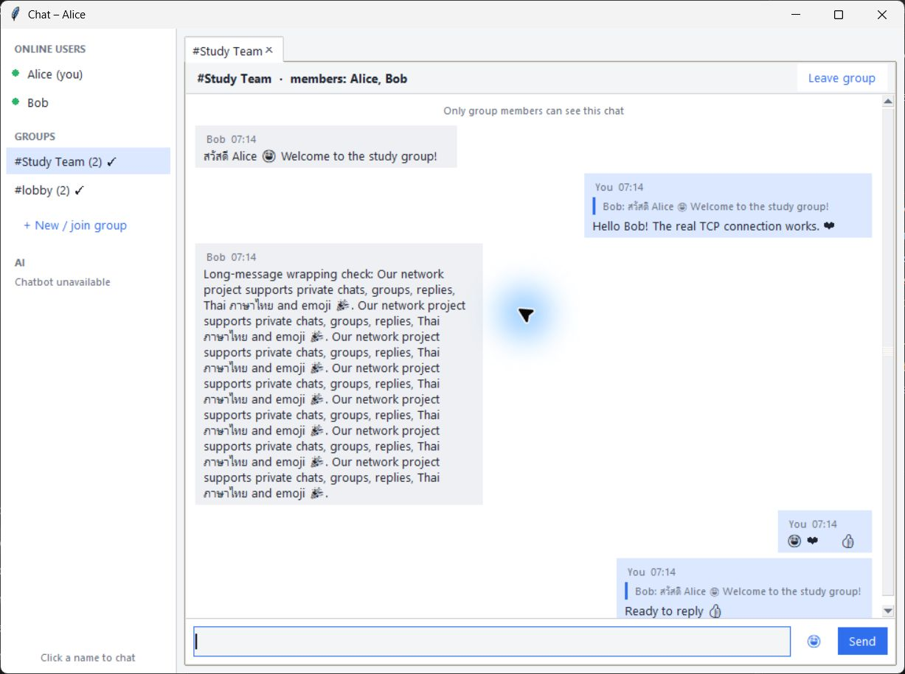
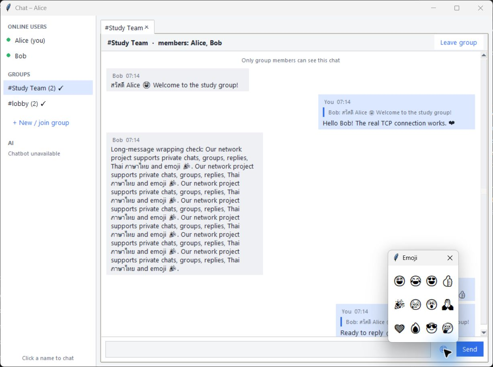
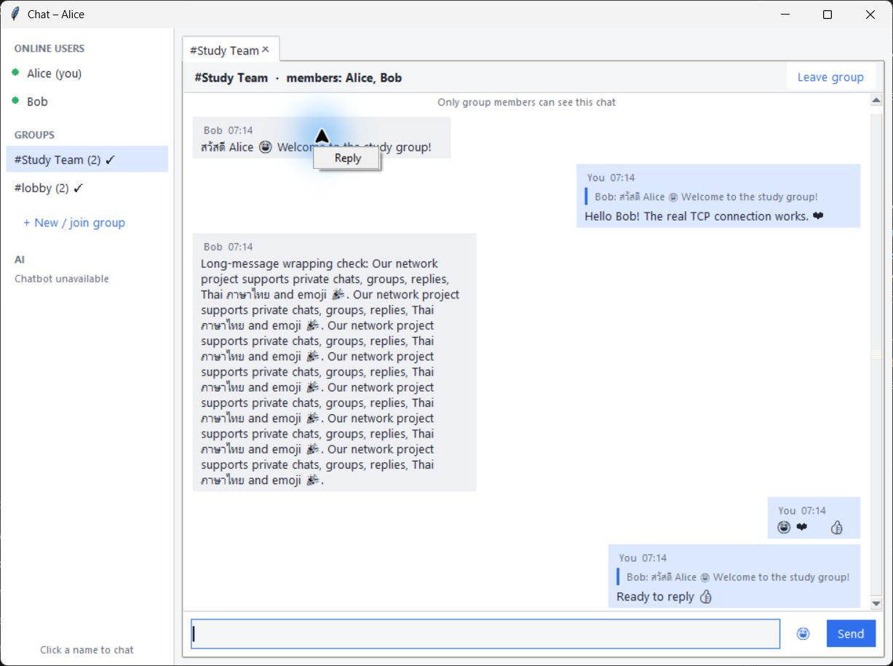
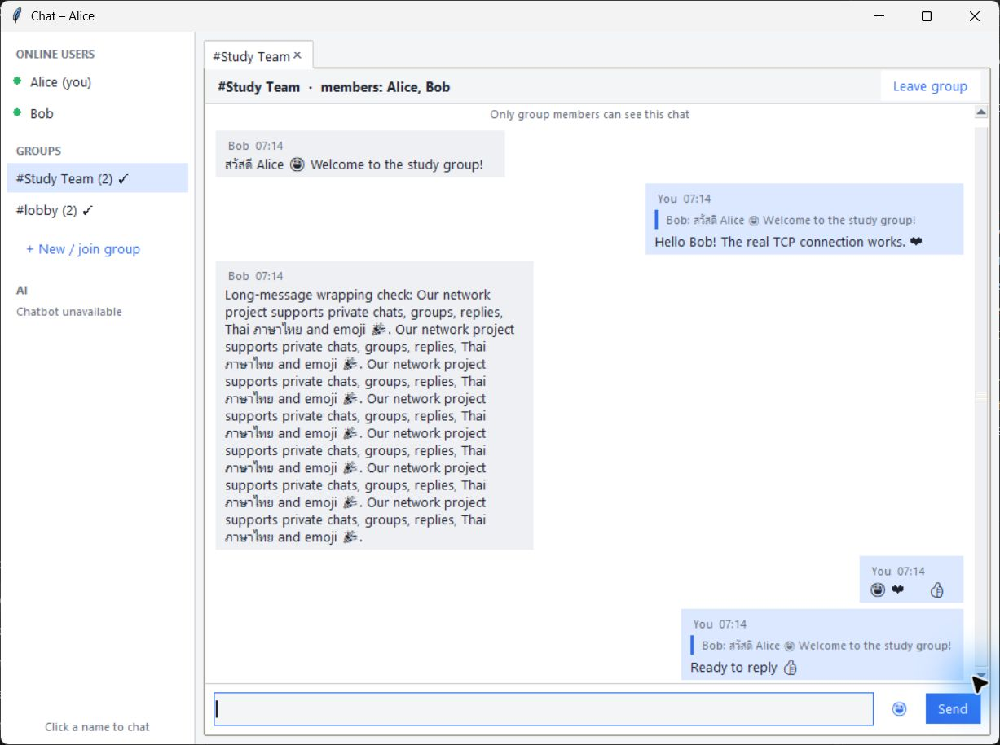
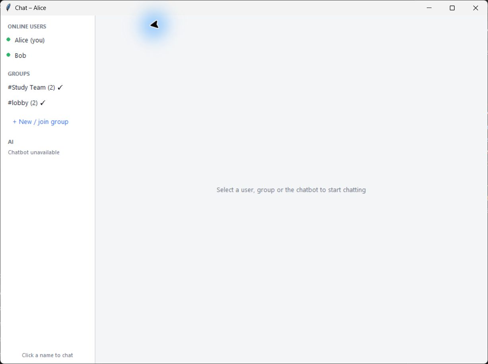

# Local desktop visual checks

Date: 2026-11-07. Environment: Windows, Python 3.14.5, native Tkinter UI.
The server, Alice's visible desktop UI, and Bob's real TCP adapter ran on the
same computer over loopback. All messages shown are synthetic test data.
This evidence does not claim two-computer LAN acceptance.

| Check | Observed result |
|---|---|
| Real group chat | Alice and Bob appeared as members; server-confirmed messages and reply quotes were visible |
| Thai and emoji | Thai text and emoji glyphs rendered; this Windows/Tk setup uses monochrome glyphs |
| Emoji-only bubble | Emoji row fits horizontally after measuring text width with the actual font |
| Long messages | Long text wrapped inside the bubble without horizontal clipping |
| Scrolling | Mouse-wheel scrolling moved between the earlier messages and latest reply; input stayed visible |
| Reply interaction | Right-click displayed Reply; choosing it showed the original-message preview; X cancelled it |
| Send control | Clicking Send submitted the selected reply and displayed its server echo |
| Emoji picker | Twelve emoji choices appeared in the popup |
| Tab close and reopen | Clicking the tab's X hid the tab and its emoji popup; clicking the group reopened retained messages |

The first visual pass exposed a floating picker after closing its tab and a
narrow emoji-only bubble. Both were fixed and visually rechecked. GUI regression
tests also cover picker cleanup when a group is left and when a tab is closed.

## Captured evidence

