# Chatbot and @mention visual checks (Person 3)

Date: 2026-11-07. Environment: macOS 27.0.1 in dark mode, Python 3.14.9, Tk 9.0.
The real server, Alice's real Tkinter window, and the helper users Bob, Carol
and Dave (real TCP clients) ran on one computer over loopback. The server sent
its Claude requests to a local stand-in for the Claude API (`FakeAnthropic` in
`tests/person3_support.py`), so the bot answers below are fixed test text, not
real AI output. All messages are synthetic test data. This evidence does not
claim two-computer LAN acceptance.

The pictures were drawn by the app window itself (AppKit `cacheDisplayInRect`),
because this Mac does not allow screen recording. They show the window content
without the macOS title bar.

| Check | Observed result |
|---|---|
| Reserved name | Logging in as `Bot` shows the reserved-name error before anything is sent |
| Chatbot room | **🤖 Chatbot** opens the bot tab; "Bot is typing…" sits under the question until the answer arrives |
| Thai answer | A five-line Thai answer wraps inside the green bot bubble |
| Mention notification | With another tab in front, a yellow bar shows who mentioned you, where, and the text, with **Open** and ✕. The chat's sidebar row turns yellow and bold with an `@` badge (`@2` after two mentions), and its tab gets an orange dot and `@2` |
| Mention highlight | The mentioning bubble is yellow and `@Alice` has a darker yellow background; other names are bold blue |
| Suggestions | `@` lists the chat's members and `🤖 @Bot` just above the chat box, lined up with the entry; `@b` narrows the list |
| Mention outside the chat | "Dave is not in this chat, so they will not see this message" appears under the sender's message |
| `@Bot` in a group | The answer quotes the question and the whole group sees it. It stays green although it starts with `@Alice`; that name is highlighted, but the bot's messages never notify |
| Smallest window (700×450) | The notification wraps onto three lines and no text is hidden; the bar and the suggestions fit together; Dave's row in the sidebar has the `@` badge for his private mention |
| Reply and suggestions | The suggestion list stays above the divider and does not cover the reply bar |

## Fixed after the first pass

- **Send, Connect, Join and Create showed no text on macOS.** macOS paints its own
  light face on `tk.Button` and ignores the blue background, so the white text
  disappeared while the window was focused. On macOS only, primary buttons now
  use bold blue text (`theme.button`). Windows and Linux are unchanged.
- **The ✕ on the mention bar was drawn as a native button with a dark frame.** It
  is now a label that darkens on hover.
- **In narrow windows the mention text was cut off under Open,** because it
  wrapped at a fixed 480 px. It now wraps at the label's real width.
- **The suggestion list covered the divider above the chat box.** It now sits
  6 px above it, at the entry's left edge.
- The reply bar's ✕ (reply feature) had a dark frame in dark mode;
  `highlightthickness=0` removes it. macOS still draws faint native edges on that
  button. A label would remove them, but `tests/test_ui_integration.py` expects a
  `tk.Button` there, so it was left as a button.

After Zian's review, the `@` on the tab alone was too easy to miss, so a mentioned
chat now also gets a yellow sidebar row with an `@` badge that counts mentions,
and an orange dot on its tab. Both clear when you open the chat.

After Yok's review on Windows, messages from the bot no longer notify. When an
answer repeated `@Bob` from the question, Bob got a second "Bot mentioned you"
bar that replaced the one from the person who tagged him. The bot's answers still
highlight names, but they stay green and cause no bar, beep or badge.

Before the fixes:

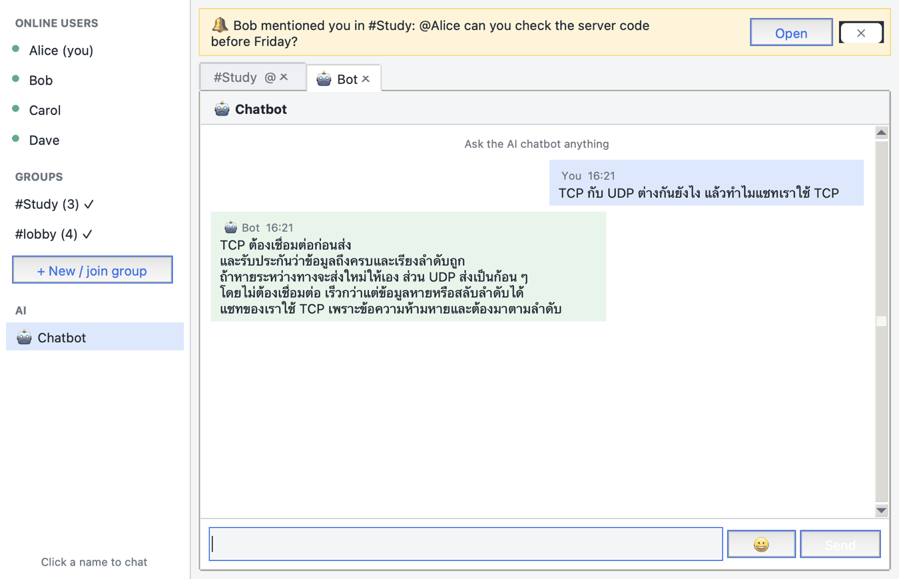

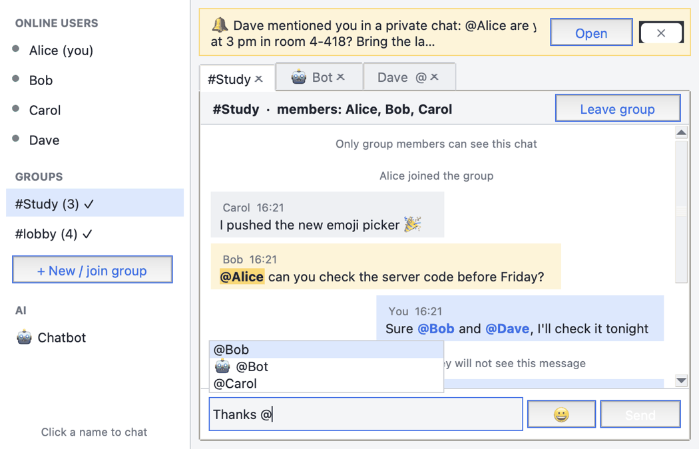

## Captured evidence

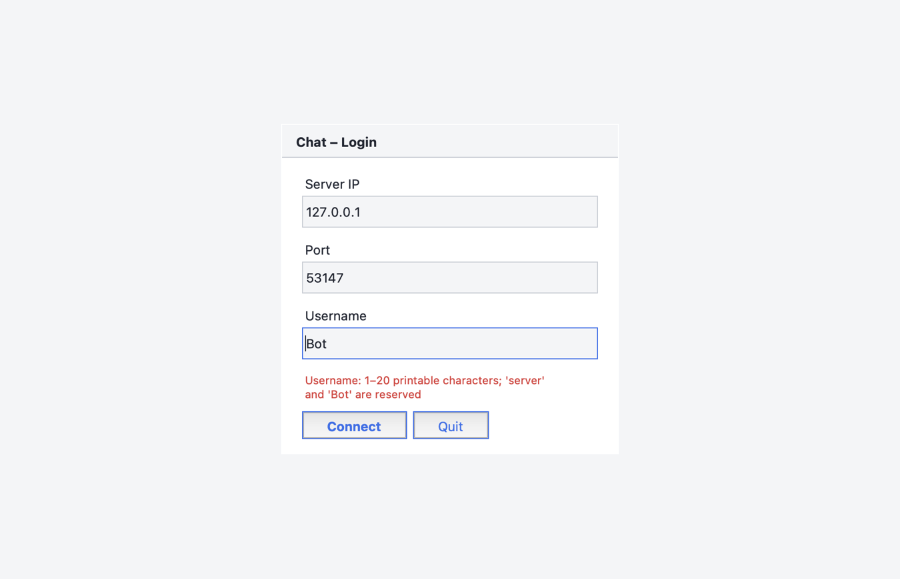

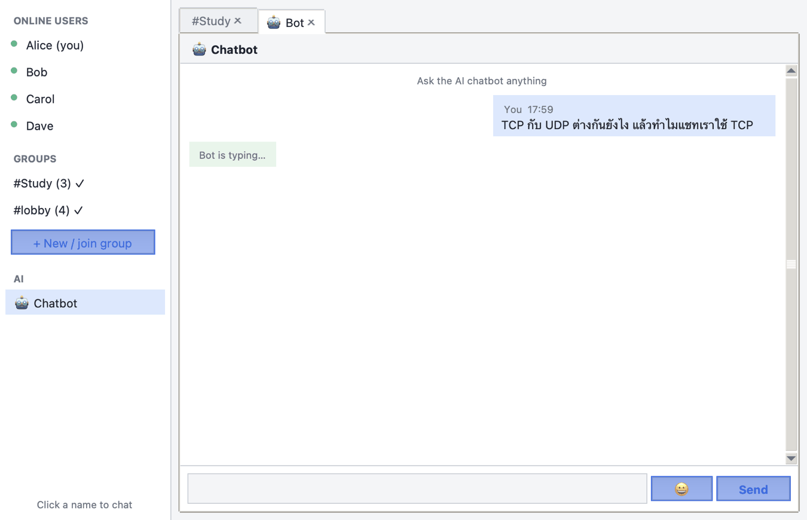

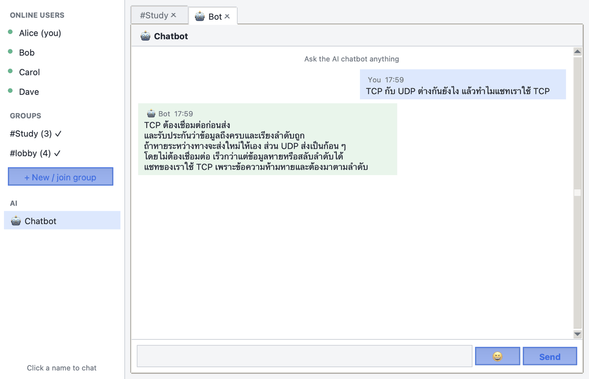

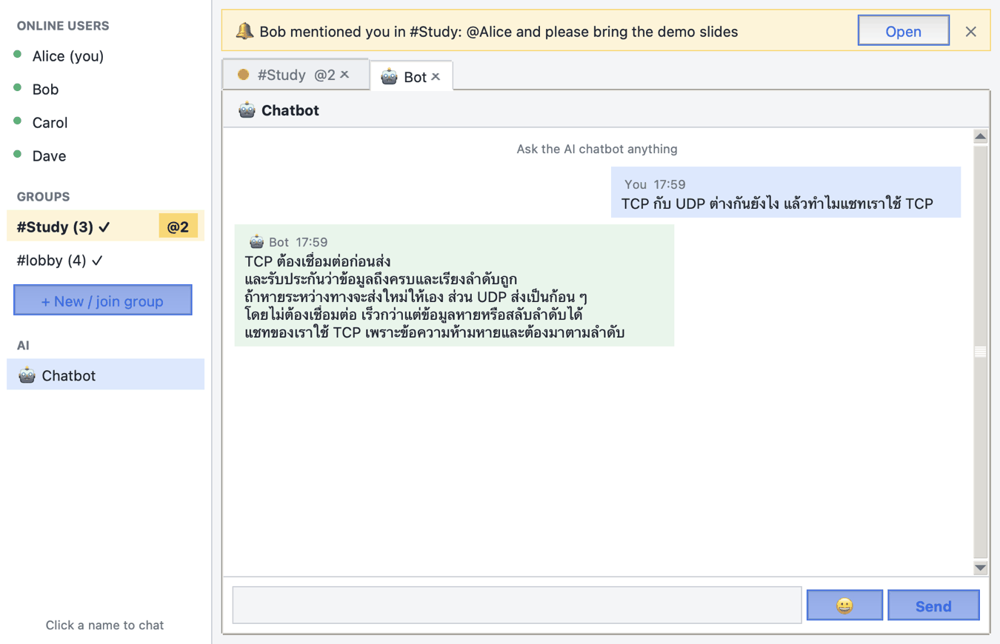

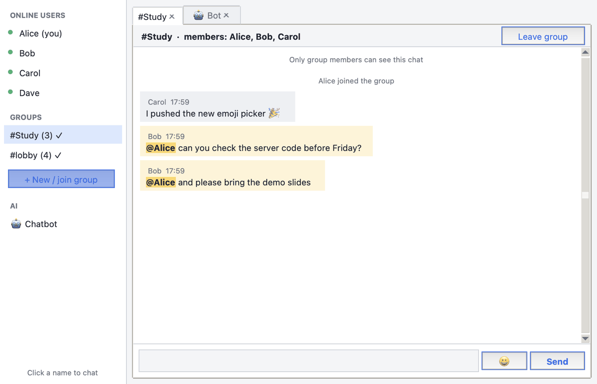

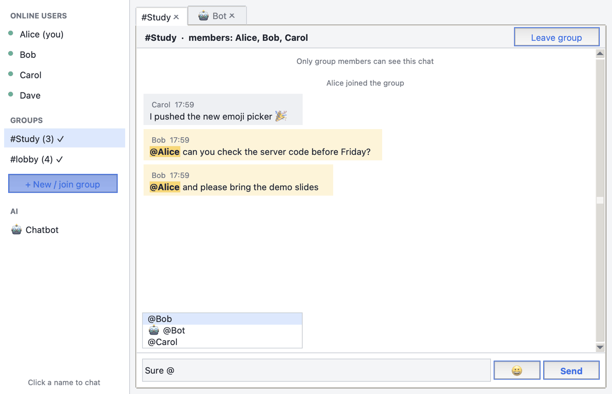

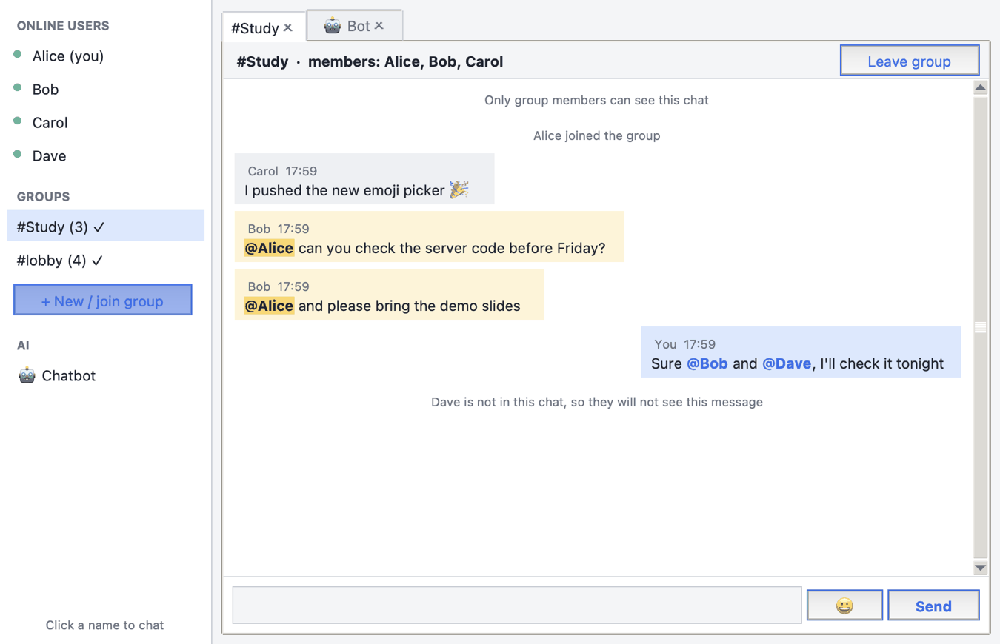

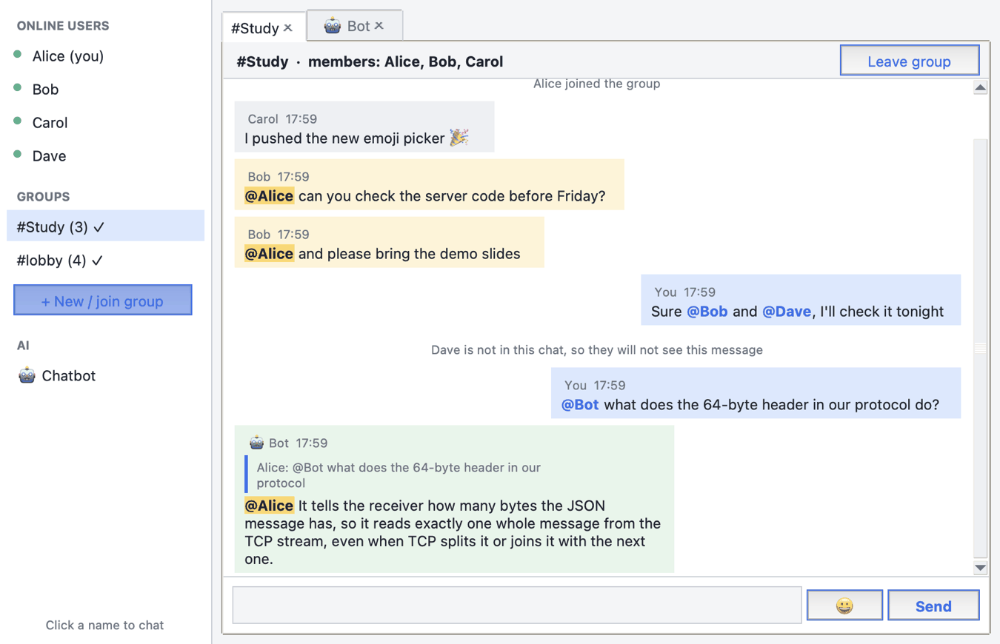

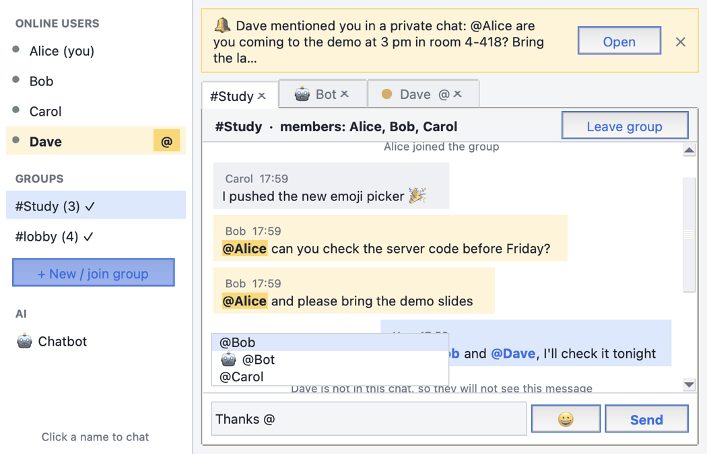

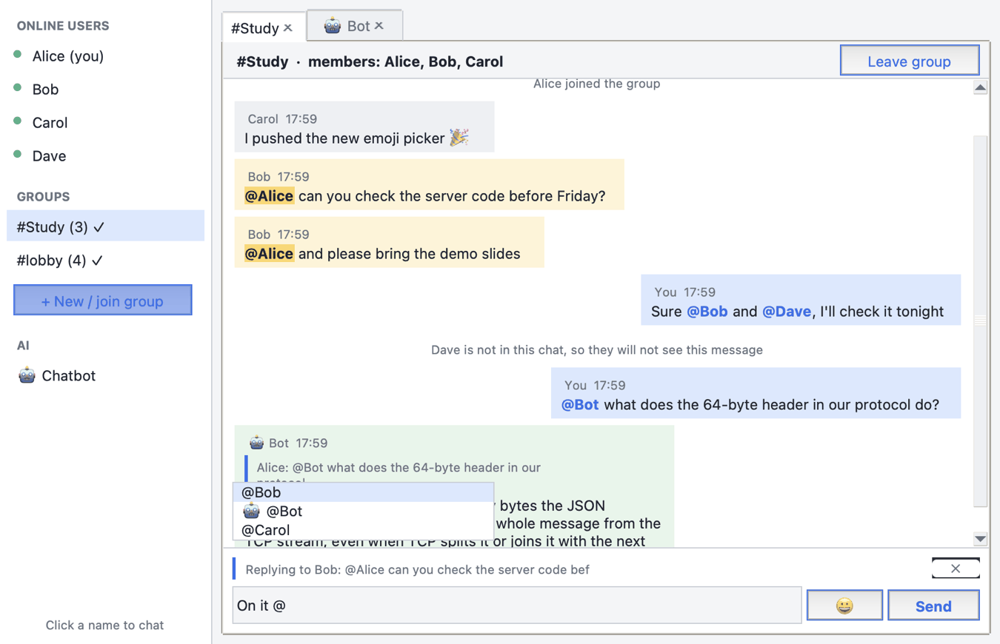

## Not covered

- A live Claude answer (needs an API key), and two physical computers.
- Windows: the pictures are from macOS. The macOS-only button change does not
  run there, and the layout changes are the same on every system.
- The emoji picker and the groups dialog on macOS, the terminal client, and
  macOS light mode.
